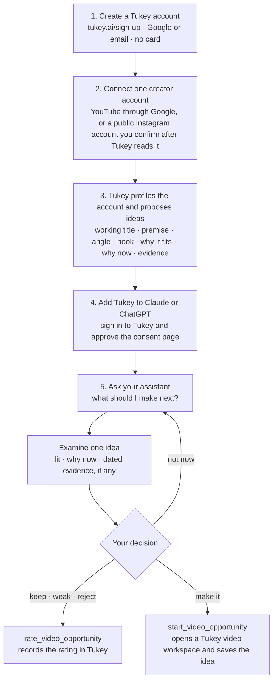

# Tukey MCP: decide what video or Reel to make next

Tukey helps a creator decide what video or Reel to make next for their **own** connected YouTube channel or confirmed public Instagram account. It studies that one account, watches the communities its audience lives in, and proposes specific ideas, each with a working title, premise, angle, hook, why it fits, why now, and the dated evidence behind it where that evidence exists. Tukey surfaces. The creator decides.

This repository is the public quickstart for connecting Tukey to an AI assistant over the Model Context Protocol (MCP). The maintained setup and support guide is **https://tukey.ai/support**; where this page and that guide differ, the guide is authoritative.

Last verified against the live product: **2026-11-08**.

- Public listing: [Claude Connectors Directory](https://claude.ai/directory/tukey) (Community connector)
- Official MCP Registry entry: [`ai.tukey/tukey`](https://registry.modelcontextprotocol.io/v0.1/servers/ai.tukey%2Ftukey/versions/latest) (latest version 0.1.1)
- Endpoint: `https://www.tukey.ai/mcp`

## Who it helps, and when

**Who it helps.** Creators who publish on YouTube or Instagram and want their AI assistant to work from their own account's evidence instead of generic trend lists; and agent builders who want a remote MCP server whose tools are scoped to one authenticated creator account.

**Use Tukey when you want to:**

- see what Tukey currently suggests you make next, and why it fits your account right now;
- check the dated sources behind an idea before you commit to it;
- have your assistant describe your account the way Tukey profiled it (topics, formats, voice, audience) before planning, titling or pitching a video or Reel;
- save, pass on, dismiss or start one of those ideas from inside the conversation, when you explicitly ask.

**Do not use Tukey for:**

- someone else's channel or account, or a general question about YouTube or Instagram;
- view counts, per-video or per-Reel performance, Instagram reach or audience analytics (Tukey has none of these; for a YouTube channel use YouTube Studio);
- publishing, editing or deleting anything on YouTube or Instagram (Tukey never does);
- a guarantee of views, growth or any other outcome (Tukey makes none);
- TikTok or any platform other than YouTube and Instagram.

## How it works



<details>
<summary>Text version of the diagram</summary>

1. Create a Tukey account at tukey.ai/sign-up with Google or email and password. No card.
2. Connect one creator account: a YouTube channel through Google, or a public Instagram account you confirm after Tukey reads it.
3. Tukey profiles the account and proposes ideas, each with a working title, premise, angle, hook, why it fits, why now and its evidence.
4. Add Tukey to Claude or ChatGPT; sign in to Tukey and approve the consent page.
5. Ask your assistant what you should make next.
6. Examine one idea: its fit, why now, and the dated evidence behind it, if it has any.
7. Decide. A rating (keep, weak or reject) goes through `rate_video_opportunity`; choosing to make it goes through `start_video_opportunity`, which opens a Tukey video workspace and saves the idea; or ask for more ideas.

</details>

Steps 1 to 3 happen in Tukey. Steps 4 to 7 can happen in your assistant. The two action tools run only when you explicitly ask.

## What is available today

- **YouTube and Instagram.** TikTok and other platforms are not available.
- **YouTube** connects through Google, which confirms that you manage the channel.
- **Instagram needs no Instagram login.** You submit a public Instagram account. Tukey reads at most 12 public Reels chosen from at most 48 observed, once, and you confirm the result. Neither public readability nor your confirmation verifies control or ownership of the account. Tukey receives no Instagram access token and reads no private Instagram data or direct messages.
- **Open registration.** Sign up at https://tukey.ai/sign-up with Google or email and password. No invitation and no payment card are needed to begin. New accounts receive three days of free access that never enrolls or charges you automatically, and Welcome Credits. See https://tukey.ai/pricing for current plans, included use and Credits. If a Tukey account does not currently have access, authorization cannot complete and no account or channel data is returned.
- **One connected creator account** per Tukey account.

## Connect Tukey to Claude

Tukey has a public listing in the Claude Connectors Directory: **https://claude.ai/directory/tukey**. It is a Community connector: Anthropic runs automated reviews on Community connectors and does not verify them.

- **From the Directory.** Open the listing, sign in to Claude, and add Tukey. Claude sends you to Tukey to sign in and approve access.
- **As a custom connector (Pro and Max).** Customize > Connectors > + Add > Add custom connector. Enter `https://www.tukey.ai/mcp` and continue with the OAuth settings Claude detects.
- **Team and Enterprise.** An Owner, or another role your organization authorizes, first adds the connector under Organization settings > Connectors with the same server address. Members then connect it under Customize > Connectors.

## Connect Tukey to ChatGPT (custom app)

Tukey has no verified listing in ChatGPT's app directory. You add it as a custom app where your plan and workspace settings allow custom MCP apps. Menu labels may vary while these features are in beta, and full MCP support, including write actions such as Tukey's two action tools, is subject to ChatGPT plan and workspace controls.

- **Business, Enterprise and Edu.** A workspace Admin or Owner, or a developer they authorize: enable Developer mode; open Settings (or Workspace settings) > Apps > Create; enter `https://www.tukey.ai/mcp` as the server URL; select OAuth and complete the authorization on Tukey's consent page; let ChatGPT scan the tools; create and enable the app.
- **Pro.** OpenAI currently limits custom MCP use on Pro to eligible read/fetch capabilities in Developer mode. Tukey has not separately canary-tested the Pro surface, so do not rely on the two action tools being available there.
- **Other plans.** If the plan does not offer custom MCP apps, Tukey cannot be connected to ChatGPT yet.

## A creator's workflow, start to finish

1. **Connect in Tukey first.** Sign up, connect your YouTube channel through Google or confirm a public Instagram account, and wait for the profile and the first ideas. Profiling and the first batch take time after an account is connected.
2. **Add Tukey to your assistant** from the Directory, as a custom connector, or as a ChatGPT custom app. On Tukey's consent page, check that the address shown (for example `claude.ai` or `chatgpt.com`) matches the assistant you are using, read what you are granting, and choose Allow. Nothing is connected until you do.
3. **Ask what to make next.** Your assistant lists Tukey's current ideas for your account, grouped as timely, evergreen or early-watch. Early-watch items are signals to follow, not recommendations.
4. **Examine one idea.** Ask why it fits your account and why now. Ask for the evidence: Tukey returns the dated public sources (community, title, link) behind that idea. Some ideas rest on account fit alone and carry no citations; a good assistant says so instead of inventing sources.
5. **Decide, explicitly.** Say "mark it as weak", "keep it", "reject it" or "start it in Tukey". Only then does the assistant call an action tool. A rating replaces any earlier rating of that idea; a reject can keep that idea and its topic from being suggested for a while. Starting an idea opens its Tukey video workspace, saves the idea (replacing any earlier rating) and returns a link; starting it again returns the same workspace.
6. **Keep going in Tukey.** The workspace, your ratings and your connections live in your Tukey account, with or without the assistant.

## Example prompts

- "What should I make next on my channel?"
- "List my current Tukey ideas and tell me which are timely."
- "Why does the first idea fit my account, and why now?"
- "Show me the evidence behind the second idea."
- "Give me a title and hook for the first idea." (an assistant grounds this in one of your current ideas rather than inventing a topic)
- "Mark the third idea as weak in Tukey."
- "Start the first idea in Tukey."

The last two are explicit requests for the action tools. An assistant should never rate or start an idea you did not ask it to.

### Illustrative output

> **Illustrative only.** The channel, ideas and sources below are invented to show the shape of a response. They are not real Tukey output, not a real creator, and not a measurement of anything.

> **Tukey's current ideas for your channel (illustrative)**
>
> **Timely**
> 1. *"The one setting that made my footage look expensive"*: a before-and-after on exposure and color choices your audience has been asking about in the comments. Why it fits: your most-watched format is the practical walkthrough, and this topic matches your gear-on-a-budget pillar. Why now: two communities your viewers frequent discussed the same frustration this week. Evidence: 3 dated sources.
>
> **Evergreen**
> 2. *"What I would buy first if I started over"*: a structured recommendation built around your recurring beginner series. Why it fits: your voice is direct and practical, and this is a question your audience keeps asking. Evidence: none. This idea rests on account fit alone.
>
> **Early-watch**
> 3. *An emerging format in your niche*: a signal to follow, not a recommendation yet. Evidence: 1 dated source.
>
> Say "show me the evidence behind idea 1" to see its sources, or "mark idea 2 as weak" or "start idea 1 in Tukey" if you have decided.

## Tools: six registered, five for the creator workflow

Tukey's server registers six tools. Five are creator-account tools: they work only on the one connected creator account and are the tools an assistant works with. The sixth, `get_profile`, is a separate identity tool marked app-only.

All six carry MCP tool annotations and can be read before connecting in the [server card](https://www.tukey.ai/.well-known/mcp/server-card.json).

### App-only identity tool

| Tool | What it does |
| --- | --- |
| `get_profile` | Returns which Tukey account approved access, including its name and email address. It returns no creator-account data and no analytics. Read only. It is registered app-only (`_meta.ui.visibility: ["app"]`): a host that implements MCP Apps visibility does not offer it to the model, which then works with the five creator-account tools; a client that does not honor that metadata may expose it. Tukey does not promise that any assistant can tell you which Tukey login is connected. |

### Read tools (never change your account)

| Tool | What it returns |
| --- | --- |
| `get_channel_profile` | Tukey's profile of the connected account: what it is about, its content pillars, formats, recurring series, voice, hooks and intended audience. For a YouTube channel it includes subscriber and video counts; for an Instagram account, its handle, profile address, display name, and public follower and post counts. |
| `list_video_opportunities` | The current video or Reel ideas for the account, each with a working title, premise, angle, hook, why it fits, why now and how much evidence backs it, grouped as timely, evergreen or early-watch. Some ideas carry no citations. |
| `get_opportunity_evidence` | The dated public sources behind one idea (community, title, link). Takes an idea id from `list_video_opportunities`. |

### Action tools (change your Tukey account; used only on your explicit request)

| Tool | What it does |
| --- | --- |
| `rate_video_opportunity` | Records a `keep`, `weak` or `reject` rating on one idea, exactly as if you had rated it in Tukey. The latest rating wins; a reject can keep that idea and its topic from being suggested for a while. |
| `start_video_opportunity` | Starts one idea as a Tukey video workspace and saves it, replacing any earlier rating of that idea. Starting the same idea again returns the same workspace and never creates a second one. |

Both action tools change only your private Tukey account. Creator-account content reads may use included content reads or Tukey Credits; see https://tukey.ai/pricing.

## Evidence and limits

- **Some ideas have no external citations.** Each idea states how much evidence backs it; an idea can rest on account fit alone. Ask for the evidence before you rely on an idea.
- **No analytics.** Tukey does not provide view counts, per-video or per-Reel performance, YouTube Analytics, Instagram reach, audience metrics or per-post analytics through MCP.
- **No publishing.** Tukey never publishes to, deletes from or modifies your YouTube channel or Instagram account, and an assistant cannot do so through Tukey.
- **No guarantees.** Tukey makes no promise of views, performance, revenue, ranking, growth or virality.
- **No TikTok.** YouTube and Instagram only.
- **Instagram:** no Instagram login, no verification of control or ownership, no access token, no private data or direct messages, and no views, private analytics, reach or verified audience data.
- **Not every Tukey Workspace feature is available through MCP.** MCP never creates accounts, connects a creator account, starts a new analysis or changes billing.

## Privacy, consent and disconnecting

- **Consent.** The assistant registers itself with Tukey (OAuth 2.1, authorization code with PKCE, dynamic client registration). Tukey's consent page names the assistant and shows the address that will receive access; read access needs `tukey:read`, the two action tools also need `tukey:write`. Access tokens are valid for at most one hour; a refresh token is issued only when you grant offline access.
- **Disconnect.** Tukey > Connections > Connected agents > Disconnect is the authoritative revocation control. It deletes that assistant's authorization and tokens on Tukey's side, and Tukey issues no new or refreshed tokens; an already-issued token is designed to be refused on its next request. Removing Tukey inside ChatGPT, Claude or another assistant may not by itself end Tukey's authorization, so disconnect in Tukey as well.
- **Your data.** Privacy Policy: https://tukey.ai/privacy-policy. Terms of Service: https://tukey.ai/terms-of-service. For questions about your personal information, or to request access to or deletion of your data, email legal@tukey.ai as the Privacy Policy describes.

## Troubleshooting

- **Cannot find the setup menu.** Labels vary by plan and while these features are in beta. In ChatGPT Business, Enterprise or Edu a workspace Admin or Owner (or an authorized developer) must create the app; in Claude Team or Enterprise an Owner adds the connector first.
- **Action tools missing.** ChatGPT capabilities depend on plan and workspace controls; Pro may be limited to read/fetch. Rating and starting always remain available inside Tukey.
- **Could not reach Tukey or sign-in failed.** Check that the address is exactly `https://www.tukey.ai/mcp`, then connect again. If you had already approved consent, remove the connection in the assistant, disconnect it in Tukey's Connections page, and connect again.
- **Consent page says the account has no access.** Contact support@tukey.ai from the address on your Tukey account.
- **Tukey says there is no channel.** Connect a YouTube channel through Google, or submit a public Instagram account and confirm it after Tukey reads it.
- **No profile or no ideas yet.** Profiling and the first ideas take time after an account is connected.
- **A rejected idea is missing.** Tukey withholds topics you declined for a while. This is expected.
- **The assistant answered a view-count question.** Tukey does not provide performance analytics; for a YouTube channel use YouTube Studio.

## For agent builders: endpoint and discovery

```
https://www.tukey.ai/mcp
```

- Transport: streamable HTTP (remote MCP). Protocol revision 2026-07-28, with the 2025-11-25, 2025-06-18 and 2025-03-26 revisions also served.
- Authentication: OAuth 2.1 authorization code with PKCE and dynamic client registration. Every request carries an access token issued for this endpoint; there is no anonymous access.
- Server card (tool list and annotations): https://www.tukey.ai/.well-known/mcp/server-card.json
- Protected resource metadata (authorization server and scopes): https://www.tukey.ai/.well-known/oauth-protected-resource/mcp
- Machine-readable product summary: https://tukey.ai/llms.txt
- Official MCP Registry: `ai.tukey/tukey`, latest version 0.1.1.

The server's instructions tell a model to use Tukey only for the user's own connected account, to list ideas with one call, to fetch evidence only when asked, to say so when no idea has citations, and to call an action tool only on the user's explicit request.

## Links

- Support and setup guide (canonical): https://tukey.ai/support
- Claude Connectors Directory listing: https://claude.ai/directory/tukey
- Official MCP Registry entry (latest): https://registry.modelcontextprotocol.io/v0.1/servers/ai.tukey%2Ftukey/versions/latest
- Sign up: https://tukey.ai/sign-up
- Pricing: https://tukey.ai/pricing
- Privacy Policy: https://tukey.ai/privacy-policy
- Terms of Service: https://tukey.ai/terms-of-service
- X: https://x.com/TukeyAI
- YouTube: https://www.youtube.com/@TukeyAI
- LinkedIn: https://www.linkedin.com/company/tukey-ai/
- Crunchbase: https://www.crunchbase.com/organization/tukey-ai

Tukey is an independent service and is not endorsed by, affiliated with, or a partner of Meta or Instagram, Google, Anthropic or OpenAI.

## Maintenance

https://tukey.ai/support is the canonical guide. This document is updated whenever the endpoint, the tool inventory, the supported platforms, the supported clients or plans, the directory listings, or availability changes, and the "Last verified" date above is refreshed at the same time.
